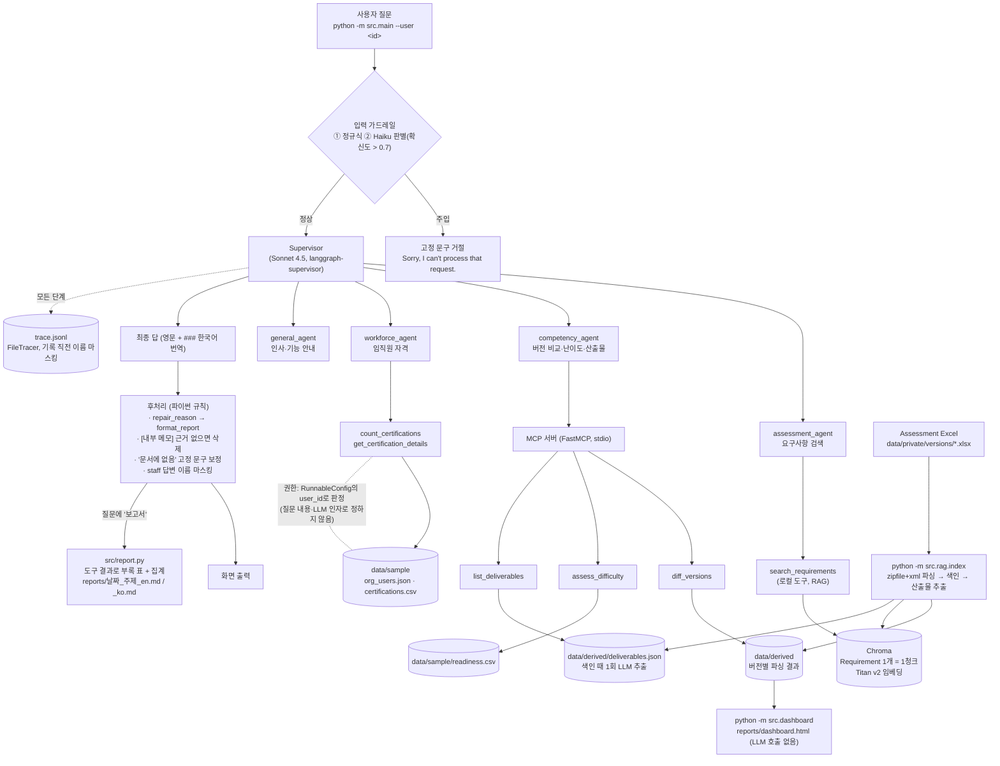
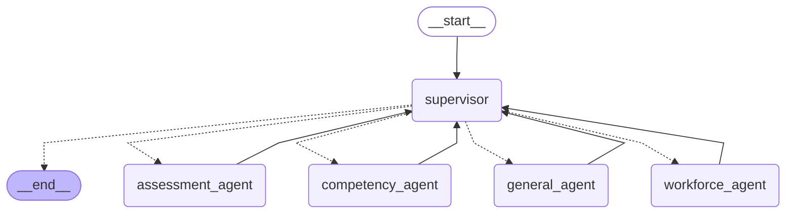

# CompassPilot 구조

> 기준 커밋: T17 (2026-11-05). 2절은 `app.get_graph().draw_mermaid()`가 자동으로 만든 그래프이고, 1절은 그 앞뒤의 가드레일·후처리·데이터를 포함한 전체 흐름이다.

## 1. 전체 흐름



| 구분 | 역할 | 판정 주체 |
|---|---|---|
| 입력 가드레일 | 프롬프트 주입 차단 | 정규식 + Haiku 4.5 |
| Supervisor | 질문 라우팅, 최종 답 작성(영문 + 한국어 번역) | Sonnet 4.5 |
| `search_requirements` | Requirement 원문 검색, `[ID: XXX-000]` 출처 | Chroma 유사도 |
| `diff_versions` | 버전 비교(추가·삭제·실질·경미·안내문) | 파이썬 규칙 |
| `assess_difficulty` | 난이도 상/중/하와 점수 근거 | 파이썬 규칙 |
| `list_deliverables` | 산출물과 고객 사례 체크리스트, 집계 | 미리 추출한 파일 + 파이썬 집계 |
| `count_certifications`·`get_certification_details` | 자격 집계(누구나), 명단(권한별) | 파이썬 규칙 |
| 후처리 | 최종 답 검증·메모 삭제·고정 문구·마스킹·보고서 부록 | 파이썬 규칙 (번역·형식만 LLM) |
| 대시보드 | 버전·난이도·산출물·자격 집계·평가 결과 | 파이썬(LLM 없음) |

## 2. LangGraph 그래프 (자동 생성)

`app.get_graph().draw_mermaid()` 출력 그대로다. 점선은 Supervisor의 조건부 이동(handoff), 실선은 하위 에이전트가 Supervisor로 돌아가는 경로다.



각 하위 에이전트는 `create_react_agent`로 만든 `agent ⇄ tools` 반복 그래프다(general_agent는 도구 없음).

다시 만들기:

```powershell
.venv\Scripts\python.exe -c "import asyncio; from src.agents import build_app; print(asyncio.run(build_app()).get_graph().draw_mermaid())"
```

## 3. 모델

| 용도 | 모델 · 리전 |
|---|---|
| Supervisor·하위 에이전트·산출물 추출 | Sonnet 4.5 (us-west-2), 대체: us-east-1 → global → Sonnet 4.6 |
| 입력 가드레일 | Haiku 4.5 (us-east-1, 대체 us-west-2) |
| 평가 judge | Sonnet 4.5 (us-west-2), 대체 없음 |
| 임베딩 | Titan Text Embeddings v2 (us-east-1) |
